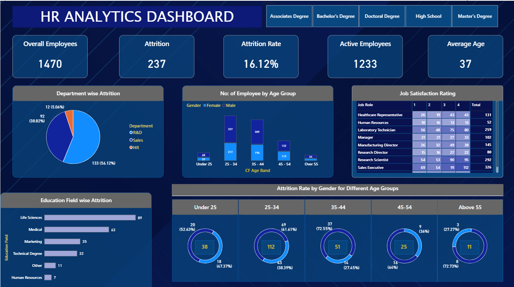

# 👥 HR Analytics Dashboard | Power BI

An interactive Power BI dashboard that analyses employee attrition and workforce demographics. It shows where employees are leaving from, which age groups and education fields are most affected, and how satisfied employees are in each job role.

---

## 📌 Project Overview

This project helps HR teams understand and reduce employee attrition. It answers questions such as:

- How many employees do we have, how many have left, and what is the attrition rate?
- Which departments lose the most employees?
- Which age groups and education fields have the highest attrition?
- How does attrition differ by gender across age groups?
- How satisfied are employees in each job role?

---

## 🖼️ Dashboard Preview



---

## 📊 Dashboard Components

- **KPI cards:** Overall Employees, Attrition, Attrition Rate, Active Employees, Average Age
- **Department-wise attrition** (pie chart)
- **Number of employees by age group**, split by gender (stacked column chart)
- **Job satisfaction rating** by job role (matrix, ratings 1 to 4)
- **Education field-wise attrition** (bar chart)
- **Attrition rate by gender** for each age group (donut charts)
- **Education level slicer buttons:** Associates, Bachelor's, Doctoral, High School, Master's

---

## 🔍 Key Insights

- **1,470** total employees, **237** attrition cases, **16.12%** attrition rate
- **1,233** active employees, with an average age of **37**
- **R&D** has the most attrition (133, 56.12%), followed by **Sales** (92, 38.82%) and **HR** (12, 5.06%)
- The **25-34** age group has the most attrition (112 of 237 cases)
- **Life Sciences** (89) and **Medical** (63) education fields have the highest attrition
- Most employees are in the **25-34** and **35-44** age bands

---

## 🎛️ Interactivity

Click the education level buttons at the top to filter every visual on the dashboard. All charts cross-filter each other.

---

## 🛠️ Tools & Skills Used

- **Power BI Desktop**: data modelling, visuals, slicer buttons
- **DAX**: attrition count, attrition rate %, active employees, age band measures
- **Power Query**: data cleaning and transformation
- **Custom dark blue theme** with KPI card design

---

## 📂 Repository Structure

```
hr-analytics-powerbi-dashboard/
│
├── HR_Analytics_Dashboard.pbix
├── data/
│   └── hr_data.csv
├── screenshots/
│   └── hr_analytics_dashboard.png
└── README.md
```

---

## 🚀 How to Use

1. Download the `.pbix` file
2. Open it in **Power BI Desktop**
3. Click the education level buttons to explore the data

---

## 👤 Author

**Sethu Santhosh**
B.Com Computer Applications | Aspiring Data Analyst
Skills: SQL · Excel · Power BI · Python

🔗 LinkedIn: _add your link_
📧 Email: _add your email_

---

⭐ If you found this project useful, consider giving it a star!
